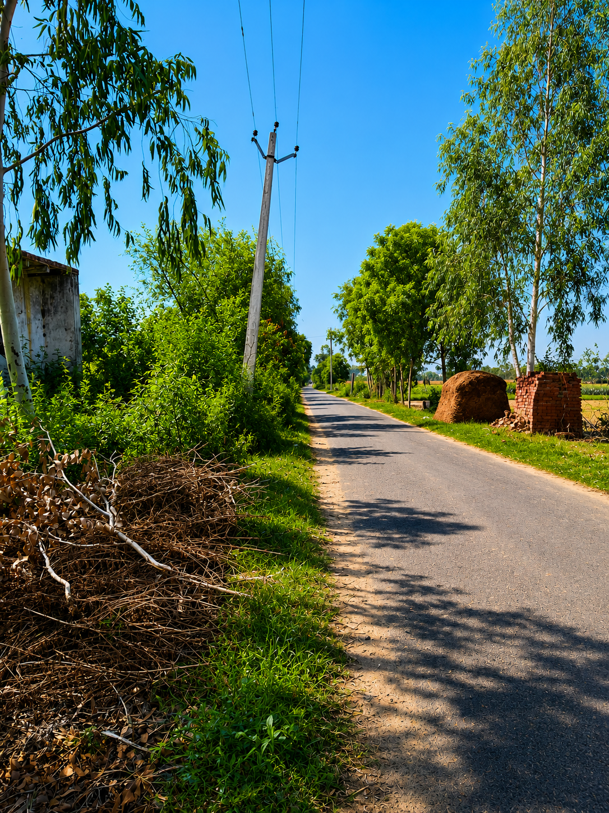

 

 

# BHAMORI KHURD
### DIGITAL VILLAGE

**Our Roots. Our Pride. Our Village.**

MITTI · YAADEN · APNA PAN

---

## 01 — Our Story

**Bhamori Khurd Digital Village** is an independent digital storytelling and visual archive project celebrating the identity, people, culture, memories and everyday beauty of Bhamori Khurd, Aligarh, Uttar Pradesh.

The idea is simple: bring our village closer to the digital world while keeping its roots, traditions and memories alive.

> *Apne Gaon Ki Apni Pehchaan.*

## 02 — Explore the Village

- **Village Identity** — discover the story and identity of Bhamori Khurd.
- **Village Archive** — photographs and moments from everyday village life.
- **Culture & Heritage** — celebrate traditions, places and shared history.
- **People & Memories** — preserve meaningful stories and local experiences.
- **Village Journey** — explore familiar lanes and places through visual storytelling.
- **Responsive Design** — an experience designed for mobile and desktop.
- **Interactive Experience** — thoughtful animations and modern frontend interactions.

## 03 — Design Philosophy

| Element | Design direction |
|:--|:--|
| Visual identity | Premium editorial village aesthetic |
| Colours | Warm ivory, forest green and muted gold |
| Typography | Modern typography with expressive headings |
| Animation | Subtle motion and visual transitions |
| Experience | Image-led, spacious and responsive |

## 04 — Village Information

**Village:** Bhamori Khurd  
**Post:** Alampur Fatehpur  
**Tehsil:** Atrauli  
**District:** Aligarh  
**State:** Uttar Pradesh, India

## 05 — Live Project

**Website:** `https://student-amankumar.github.io/Mera-Gaon/`

## 06 — The Vision

To create a meaningful digital space where village life, local identity, photographs, traditions and memories can be experienced through modern web technology.

This project is also a frontend development and digital storytelling initiative focused on learning, creativity and cultural preservation.

---

### CREATED BY AMAN KUMAR

Developer · Digital Creator

[GitHub](https://github.com/student-AmanKumar) · [LinkedIn](https://www.linkedin.com/in/aman-kumar-462a21316/) · [Portfolio](https://student-amankumar.github.io/aman-digital-space/)

 

**BHAMORI KHURD · ALIGARH · UTTAR PRADESH**

*Made with respect for our roots and love for our village.*

Copyright © 2026 Aman Kumar. All rights reserved.

Original project code, design and written content may not be reproduced or republished without permission. Third-party assets remain subject to their respective owners' rights and licences.

This is an independent community and portfolio project. It is not an official government or Gram Panchayat website.

