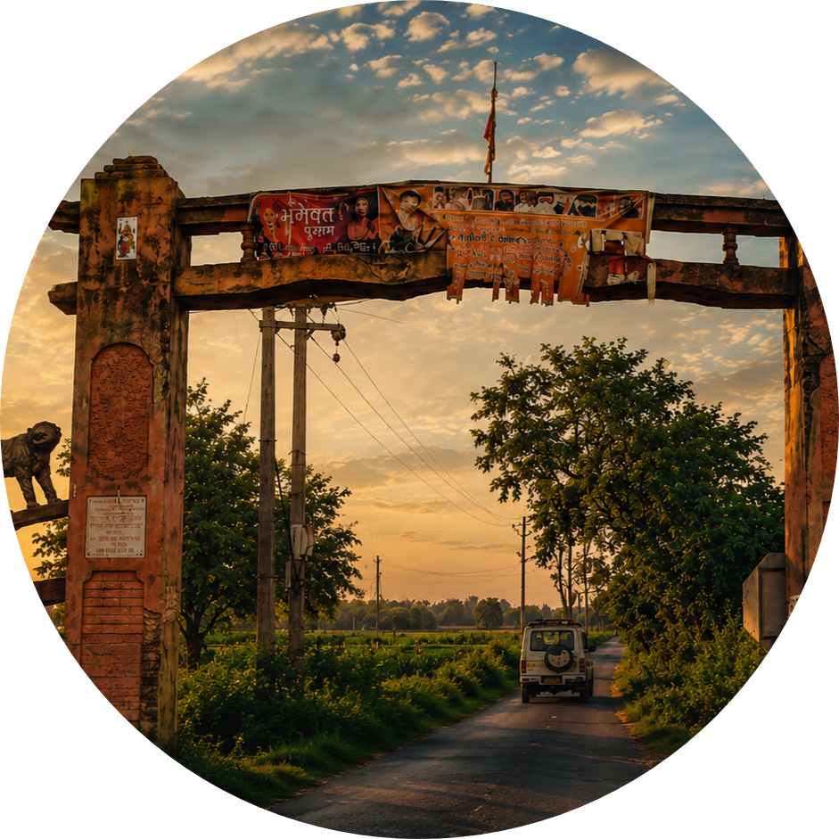

# Bhamori Khurd — Digital Village

<p align="center">
  
</p>

<h3 align="center">Our Roots. Our Pride. Our Village.</h3>

<p align="center">
  A digital home for village stories, local heritage, memories, and the beauty of everyday life.
</p>

<p align="center">
  
  
  
</p>

---

## 🌿 About the Project

**Bhamori Khurd — Digital Village** is an independent digital storytelling and cultural preservation project created to celebrate the identity, heritage, people, and everyday life of Bhamori Khurd.

The project brings the spirit of village life into a modern digital experience, creating a place for local stories, photographs, familiar locations, traditions, and memories.

Its purpose is to preserve meaningful moments, celebrate local identity, and connect generations through digital storytelling.

> *Mitti se rishta, yaadon se pehchaan.*

## 📍 Village Information

| Detail | Information |
|---|---|
| Village | Bhamori Khurd |
| Post Office | Alampur Fatehpur |
| Tehsil | Atrauli |
| District | Aligarh |
| State | Uttar Pradesh |
| Country | India |

## ✨ Project Features

- **Village Introduction** — A digital introduction to Bhamori Khurd.
- **Village Archive** — A visual collection of village life, nature, culture, and people.
- **Stories & Memories** — Digital storytelling inspired by everyday village experiences.
- **Local Heritage** — A space to celebrate traditions, familiar places, and community memories.
- **Village Journey** — A visual journey through selected village streets and locations.
- **Interactive Elements** — Navigation, animations, and engaging interface experiences.
- **Community Messages** — A way for visitors to share feedback and messages.
- **Responsive Experience** — Layouts designed for desktop, tablet, and mobile devices.

*Features and content may evolve as the project develops.*

## 🎨 Design Philosophy

The visual identity combines the warmth of rural India with a refined, modern editorial style.

- Warm cream and ivory backgrounds
- Forest-green visual accents
- Subtle gold details
- Clean typography and thoughtful spacing
- Smooth transitions and animations
- Photography-led storytelling
- Responsive layouts for different screen sizes

The goal is to create a digital experience that feels personal, welcoming, and rooted in the village's identity.

## 🛠️ Technology Stack

<p>
  
  
  
  
</p>

| Technology | Purpose |
|---|---|
| HTML5 | Page structure and content |
| CSS3 | Styling, responsive layouts, and animations |
| JavaScript | Interactive features and dynamic behaviour |
| GitHub Pages | Website hosting and deployment |

## 🚀 Live Website

Explore the deployed project:

**Live URL:** `ADD-YOUR-GITHUB-PAGES-URL-HERE`

Replace this placeholder with the actual URL of your deployed website.

## 📂 Repository Structure

```text
Bhamori-Khurd-Digital-Village/
│
├── index.html
├── README.md
├── css/
├── js/
└── images/
    ├── logo.png
    └── ...
```

*Illustrative structure only. Actual filenames and directories may differ.*

## 🌱 Vision

Every village has a story worth preserving.

Behind every street, field, tradition, and familiar face is a memory that deserves to live beyond the moment. This project aims to create a growing digital archive that celebrates those details and keeps the connection with home alive.

**Rooted in our village. Preserved for tomorrow.**

---

## © Copyright & Intellectual Property

**Copyright © 2026 Aman Kumar. All Rights Reserved.**

Bhamori Khurd — Digital Village is an independently developed educational, cultural, and digital storytelling project.

Unless otherwise stated, original project-specific materials—including custom-written text, website design, original graphics, branding, and custom-created visual elements—are protected by applicable copyright and intellectual property laws.

### Usage Restrictions

Without prior written permission from the relevant rights holder, you may not:

- Reproduce or republish protected original project content.
- Copy or redistribute original written material, custom graphics, or website designs.
- Reuse project-specific branding or visual identity in a way that implies ownership, endorsement, or affiliation.
- Present the creator's original work as your own.
- Use protected original materials for commercial purposes without appropriate authorization.

### Third-Party Materials

Photographs, logos, fonts, libraries, trademarks, and other third-party resources may belong to their respective owners and remain subject to their own licences, permissions, and terms of use. This notice does not claim ownership over third-party materials or content belonging to other individuals.

### Permission & Contact

For permission to reproduce or reuse protected original materials, contact the project creator through the profile links below.

**Project:** Bhamori Khurd — Digital Village  
**Creator:** Aman Kumar  
**Year:** 2026

**Notice:** Viewing a public website does not automatically grant permission to reuse its protected original content. A copyright notice does not technically prevent copying, and legal rights depend on the applicable law and the ownership of each material.

---

## 👨‍💻 Created By

**Aman Kumar**  
Frontend Developer · Digital Creator

An independent project combining web development, digital creativity, and an appreciation for local culture and village heritage.

<p>
  <a href="https://github.com/student-AmanKumar">GitHub</a> ·
  <a href="https://www.linkedin.com/in/aman-kumar-462a21316/">LinkedIn</a> ·
  <a href="https://student-amankumar.github.io/aman-digital-space/">Portfolio</a>
</p>

---

<p align="center">
  <strong>BHAMORI KHURD · ALIGARH · UTTAR PRADESH, INDIA</strong>
  <br><br>
  <sub>Made with purpose. Inspired by our roots.</sub>
</p>

<p align="center">
  <sub>This is an independent educational and cultural project. It is not an official government, Gram Panchayat, or legal-services website.</sub>
</p>